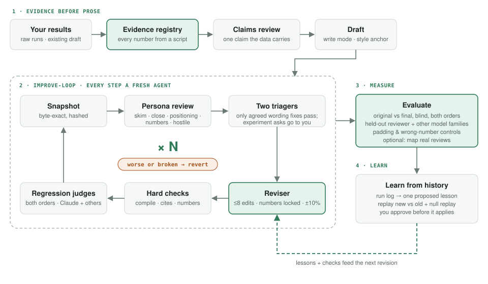

# paperloop

**A Claude Code plugin that turns experiment results into a paper, and improves an existing paper with a review-and-revise loop that learns from its own history.**

<p align="center"></p>

```
/plugin marketplace add debsagar/paperloop
/plugin install paperloop@paperloop
/paperloop:start
```

**What makes it different from "ask a model to polish my paper":**
- **Numbers are locked.** An evidence registry recomputes every number from raw files; prose numbers come from generated LaTeX macros; a checker fails the build if any number in the paper cannot be traced (and fails if it finds nothing to check).
- **Gates are scripts, not instructions.** Compile, citations, references, length, banned bookkeeping phrases and number coverage all exit non-zero. Revert restores a byte-exact snapshot.
- **The reviewer that measures is never the reviewer that steers.** Inside the loop, five fixed-viewpoint reviewers rotate; a separate held-out reviewer is used only for before/after measurement.
- **Not only Claude grading Claude.** Optional cross-family reviewers and judges via OpenRouter, free models by default.
- **It learns, carefully.** Every review, triage label, edit, check and judgement goes to a run log. `/paperloop:learn` proposes one lesson at a time, replay-tests it against past iterations (with a null replay to measure judge noise), and applies it only when you approve.
- **It checks for machine-sounding prose.** A tell counter (`paperloop-aitells`) and a meta-judge that knows LLM and Claude writing habits run on every revision and at evaluation, on a non-Claude model too. A revision may never add machine-prose habits, and the evaluation fails a final that reads more AI-generated than the original. The final question goes to a person: does this read AI-generated?
- **Packaging only.** Complaints that need new experiments are routed to you, never "fixed" with words.

## Install

From a git host :
```
/plugin marketplace add debsagar/paperloop
/plugin install paperloop@paperloop
```
From a local clone:
```
claude --plugin-dir /path/to/paper-pipeline          # one session
# or permanently:
/plugin marketplace add /path/to/paper-pipeline
/plugin install paperloop@paperloop
```
To offer it automatically to everyone who opens a team repo, commit this to that repo's `.claude/settings.json`:
```json
{
  "extraKnownMarketplaces": { "paperloop": { "source": { "source": "github", "repo": "debsagar/paperloop" } } },
  "enabledPlugins": { "paperloop@paperloop": true }
}
```
(Teammates accept the folder-trust prompt, then run `/plugin install paperloop@paperloop` once.)

**Requirements:** Python 3.9+ (scripts use only the standard library); a LaTeX compiler — `tectonic` (recommended, self-contained), `latexmk` or `pdflatex`; `pdftotext` (poppler-utils) for cross-family review of PDFs. Optional: an OpenRouter key in `OPENROUTER_API_KEY` or an env file.

## Use

Open Claude Code in your project and run `/paperloop:start`. It asks only what it cannot find (mode, venue, field, results directories, a style-anchor paper, paths the loop must never read, cross-family review on/off) and writes `.paperloop/config.json`.

| Command | What it does |
|---|---|
| `/paperloop:start` | welcome, setup, current status |
| `/paperloop:project-log` | `PROJECT-LOG.jsonl` event ledger + `DECISIONS.md` closed decisions |
| `/paperloop:registry` | evidence registry: every reportable number from raw files, `numbers.tex` macros |
| `/paperloop:claims-review` | sceptical claims review + story plan before writing |
| `/paperloop:anchor` | choose and vet a style-anchor paper (never the paper itself) |
| `/paperloop:draft` | write mode: one writer pass, then checks and an independent number audit |
| `/paperloop:check` | all hard checks now, including the machine-prose tell count |
| `/paperloop:review` | one held-out blind review (+ other model families), triaged |
| `/paperloop:improve` | the revision loop, N iterations (workflow `improve-loop`) |
| `/paperloop:evaluate` | original vs final: blind, both orders, controls, optional official-review mapping |
| `/paperloop:learn` | outer loop: propose one lesson from history, replay-test, owner approves |

Typical revise run: `/paperloop:start` → `/paperloop:registry` → `/paperloop:improve` (5 iterations) → `/paperloop:evaluate` → `/paperloop:learn`.

## Headless / CI runs

`claude -p "/paperloop:improve ..."` works, but workflows run in the background: set `CLAUDE_CODE_PRINT_BG_WAIT_CEILING_MS=0` or the CLI stops the loop 10 minutes after the main turn ends. Workflows in `-p` need `Workflow` permission (e.g. `--permission-mode bypassPermissions` in a sandbox, or `--allowedTools Workflow,...`).

## The loop

Each iteration runs every step in a fresh agent, as in the diagram above. If the hard checks fail after one repair, or the judges prefer the previous version, the iteration is reverted byte for byte. `/paperloop:evaluate` then compares original and final. `/paperloop:learn` reads the run log and proposes one lesson; you approve it before the next revision reads it.

Lessons are read in layers: plugin `lessons/seed.md` (a starting history from one author's papers, each line tagged with its source) → `~/.claude/paperloop/lessons.md` → `.paperloop/lessons.md`. The loop never edits the plugin; promoting a lesson to the team means a pull request with its evidence.

## What is on disk (`.paperloop/` in your project)

`config.json`, `state.json`, `registry.json` / `registry.py` / `numbers.tex`, `claims_review.md`, `lessons.md`, `banned.txt`, `runs.jsonl` (the history the outer loop learns from), `snapshots/`, `iters/`, `reviews/`, `eval/<tag>/REPORT.md`, `proposals/`. Commit `config.json`, `lessons.md`, `banned.txt` and `runs.jsonl`; snapshots are disposable.

## Honest limits

- Every Claude judge shares a model family with the reviser; self-preference is reduced (both orders, controls, cross-family judges, held-out reviewer), not removed. Your own blind read is the only non-model signal.
- Free OpenRouter models are rate-limited and weaker than frontier models; they break the single-family echo, they are not expert reviewers. As machine-prose detectors they failed: a free model rated a human-written paper more machine-like than an LLM-written one, so their prose scores are shown but never decide. The deterministic tell counter separated five human papers (0-6.5) from two LLM drafts (17-19).
- The thresholds (≥4 sections, ≤70% complaints, ≥75% replay wins) are design choices, not validated.
- Packaging moves a paper about one point on a 10-point scale at best. If the reviewer's top complaint needs an experiment, run the experiment.

## Tests

`python3 tests/test_bin.py` — self-checks for every script (planted wrong number fails, stripped paper fails, byte-exact restore, all-or-nothing logging).

Includes ideas and some check designs from the PaperOrchestra community skill pack (MIT, © 2026 ar9av) and the PaperOrchestra paper (Song et al., arXiv:2604.05018); no code or prompts are copied. See NOTICE.
